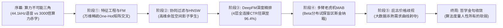

# Vibe 知识大赏 · 工业级 AI 知识视频制作引擎 (V2.1)

> **目标**：用纯代码（HTML5 Canvas 2D + Playwright GPU 多并发光栅化 + NVIDIA NVENC 硬件压制）制作"Vibe知识大赏"风格的电影感知识短视频——**无旁白配音、全画面文字叙事、深空蓝黑底、历史经典文献与工业模型推演、活态物理动力学动效、哲学金句卡片收尾**。成片规格严格锁定 **1920×1080 / 30fps / 2:30–2:50 (典型160.0s / 4800帧) / MP4**。

---

## 〇、生产标准与风格 DNA

| 维度 | 工业级硬性规范 |
|---|---|
| **画幅与帧率** | **1920×1080 横屏，严格 30fps** |
| **标准时长** | **严格 2:30 ~ 2:50**（标准锁定 160.0 秒 / 4800 帧，符合平台高完播黄金区间） |
| **声音轨** | **无配音旁白**。**统一使用共享 BGM `assets/audio/MidnightRush(旋律很哇塞)-云杪栖光.mp3`**（唯一默认音源，不逐期合成、不改写源文件）；**必须从 00:00:00 起播放**，尾部严格 2.5s 音频淡出（`afade`），成片端做 `-14 LUFS / TP -1` 响度归一；112.90 BPM 卡点网格见 [`references/bgm-beat-map.md`](references/bgm-beat-map.md)。可选叠加**语义音效层**（`assets/sfx.json` → `make_sfx.py` → `assets/sfx.wav`），只做转场 / 落点 / 动作点缀，不替代 BGM |
| **视觉基调** | 深蓝黑渐变 `#0F0D24` $\to$ `#080716` $\to$ `#03020A`，微粒子暗星微闪，全片基调恒定 |
| **五区架构** | 1. 左上角 `@anran` 水印（恒定）<br>2. 顶部金色场景/模型标签<br>3. 中央活态可视化动画区<br>4. $y \approx 70\%$ 动态学术注释<br>5. $y \approx 85-91\%$ 双语旁白字幕（胶囊悬浮框，中文字幕+英文斜体） |
| **标题卡** | **约 16–24 秒处落《片名》标题卡**（模板默认 16–22s；实际成片按 BGM 小节对齐，通常 17.3–23.7s）：VIBE 知识大赏 大写标签 + 金色大字片名 + 中英双语核心提问 |
| **水印与年份** | 当前年份严格标注为 **2026**；作者水印统一为 **`@anran`** |
| **片尾收敛** | **禁止罗列枯燥学术书单**；必须使用震撼哲理性金句卡片升华收尾 |

---

## 一、活态动效四大铁律 (Live Motion Laws)

> 拒绝 PPT 幻灯片与死板图表！画面逐秒实测运动均值必须保持高频活态（任何静止画面不得连续停留 > 4 秒）。

### 1. 欠阻尼物理运动 (Damped Physical Oscillations)
- **绝对禁止死角倾斜**：例如天平、指针、钟摆，绝不能写死角度。
- **物理运动公式**：
  $$\theta(t) = \theta_0 + e^{-\gamma t} \sin(\omega t) \cdot A + \sin(2.5 t) \cdot \delta$$
  - 前 1 秒平衡 $\to$ 1-3.2 秒极速坠落 $\to$ 3.2 秒后阻尼回弹衰减，并保持 $\pm 1.5$px 的终生微呼吸浮动。

### 2. 动态数值狂飙滚轮 (Dynamic Rolling Counters)
- 关键指标（如 CTR 预测率、准确率、算力金额）必须使用 `easeOut` 实时数字狂飙滚动展示（例如从 `10.0%` 狂飙至 `96.4%`），极具视觉冲击力与算法压迫感。

### 3. 活态分布与波形脉冲 (Live Waves & Distributions)
- 拓扑网络必须配有高能粒子流沿连接线穿梭。
- 概率模型（如 $\text{Beta}(\alpha, \beta)$）需随时间动态收窄或呼吸波动，直观呈现收敛过程。
- 声学特征必须配有活态多频正弦叠加波形。

### 4. 卡片边界安全锚定 (Safe Margin Anchor Rule)
- **规避 Canvas 边缘溢出/截断陷阱**：禁止使用 `x + width - 写死常量`。
- **右对齐法则**：卡片右侧文本必须显式设置 `ctx.textAlign = 'right'`，并将 $X$ 坐标锚定在 `cardX + cardWidth - safetyMargin`（安全边距 $\ge 20\text{px}$）。

---

## 二、六阶工业级装甲叙事架构 (6-Stage Armor Pipeline)

> 解决“一句话太长、知识点太少”的通病。全片必须构筑 5~6 阶段环环相扣的真实工业级推荐模型推演链：



---

## 三、RTX 2060 GPU 硬件加速全量渲染流水线

> 放弃单线程与慢速 CPU 渲染！全面使用 Playwright 多页面 D3D11 硬件光栅化 + NVIDIA NVENC 硬件压制架构。

### 1. 架构参数配置
- **GPU 光栅化**：`--enable-gpu` `--use-angle=d3d11` `--enable-gpu-rasterization` `--enable-zero-copy`
- **Worker 并发**：8 个无头 Chromium 页面并行分片截图，4800 帧仅需约 180 秒（~26.5 fps 平均吞吐）。
- **NVENC 硬件压缩**：`h264_nvenc -preset p6 -tune hq -cq 19 -pix_fmt yuv420p`（26 秒完成全片压制）。
- **音频对齐合成**：从共享 MP3 严格提取 `00:00:00` 起的 160.0s，经 `loudnorm=I=-14:TP=-1` → 末尾 `afade=t=out:st=157.5:d=2.5` → AAC 192k 混流；源 MP3 不做任何改写。

### 2. 一键执行生产指令
```bash
# 方式 A：双击项目根目录批处理脚本（自动读取 episodes/CURRENT）
render_and_mix.bat

# 方式 B：Python 命令行执行（不指定 --html 时读取 episodes/CURRENT）
python scripts/gpu_master_render.py --duration 160.0 --fps 30 --workers 8

# 指定某一期或归档页面
python scripts/gpu_master_render.py --html episodes/procrastination/index.html
python scripts/gpu_master_render.py --html episodes/archive/index_drone.html

# 只检查清单/路径/时长，不渲染
python scripts/gpu_master_render.py --dry-run

# 默认不覆盖；需要覆盖或额外复制桌面副本时
python scripts/gpu_master_render.py --overwrite
python scripts/gpu_master_render.py --copy-to-desktop
```

成片默认写入 `episodes/<slug>/dist/<slug>_v<版本>_<片名>.mp4`；归档页写入 `episodes/archive/dist/`。桌面副本只是交付副本，不是归档。

### 3. 语义音效层（可选，不替代 BGM）

- **源文件**：`episodes/<slug>/assets/sfx.json`（cue 表，入库）；`assets/sfx.wav` 是生成物，被 `.gitignore` 忽略。
- **生成**：`python scripts/make_sfx.py episodes/<slug>/assets/sfx.json` → 44.1kHz 立体声 WAV，母带峰值默认 -6 dBFS。
- **清单**：`episode.json.sfx` 指向生成的 WAV（如 `episodes/<slug>/assets/sfx.wav`）；缺失时渲染器直接报错，`--no-sfx` 可显式关闭。
- **时间写法**：`{"bar": 8, "beat": 0.6}` 对齐共享 BGM 网格，或 `{"t": 14.35}` 绝对秒；反向 whoosh 用 `"align": "end"`。
- **可用类型**：`page_turn / book_close / whoosh / reverse_whoosh / stamp / chime / descend / grow / projector / film_roll / engine / riser / impact / printer / tick_run / breath / thump / click`。
- **混音**：BGM 与音效 1:1 → `amix normalize=0` → `alimiter=0.95` → `-14 LUFS / TP -1` → 2.5s 淡出；V1 `--sfx` 与 V2 自动混音口径一致。
- **预览**：页面 `CFG.sfx = 'assets/sfx.wav'` 后，播放器同步 BGM 与音效；`__RENDER_MODE__` 下不播放音频。

```json
{
  "duration": 160.0, "bpm": 112.90, "bar0": 0.228, "masterPeakDb": -6.0,
  "cues": [
    {"type": "page_turn", "at": {"bar": 0, "beat": 0.6}, "gain": -15, "pan": -0.15},
    {"type": "impact", "at": {"bar": 44}, "gain": -6, "pan": 0.0}
  ]
}
```

---

## 四、抖音发布全案文案与置顶策略

### 1. 发布主文案模板
```text
Vibe知识大赏 | 《片名》核心悬念钩子？

[痛点场景：你刚在日常中无意提起某物，手机首页赫然推送，所有人都深信被麦克风窃听]

[硬核破局：从体系结构与算力经济学切入，全天候语音转写成本是矩阵推理的 3000 倍以上]
[工业模型推演：FM 因子分解机毫秒级稀疏特征交叉 + HNSW 向量检索 + DeepFM 深度精排 + Robbins 多臂老虎机利用与探索博弈]

[终局哲学金句升华：在被完全度量的世界里，算法没有读心术，它只是用数学度量了人性所有的软弱。]

#vibe知识大赏 #AI把知识拍成大片了 #claude5.5 #大数据 #算法推荐 #商业内幕 #硬核科普 @anran
```

### 2. 作者置顶互动评论模板
```text
【作者置顶】
你经历过最不可思议的一次“精准推荐”是什么？
测算显示：如果你关闭麦克风权限，推荐精准度仅仅下降不足 0.3%，但如果你关闭手机的重力加速度传感器和蓝牙信令，精准度会瞬间暴跌 40% 以上。

📚 本片参考文献：
1. Steffen Rendle (2010). Factorization Machines (IEEE ICDM).
2. Arthur Cecil Pigou (1920). The Economics of Welfare.
3. Herbert Robbins (1952). A Study of the Multi-Armed Bandit Problem.
4. Guorui Zhou et al. (2018). Deep Interest Network for CTR Prediction.
```

---

## 五、项目工程资产索引

### 落盘铁律

1. **一期一目录**：工程与媒体产物只写入 `episodes/<slug>/`；项目根目录禁止出现 `final.mp4`、`out_frames/`、`preview/`、`bgm.wav` 等生成物。
2. **唯一清单**：`episodes/<slug>/episode.json` 记录 `slug / title / version / status / duration / fps / publishDoc / bgm / sfx（可选）/ supersedes / supersededBy`。渲染前先读清单，不靠片名猜。
3. **固定子目录**：`dist/`（成片主档 + `.render.json`）、`preview/`（抽帧）、`qa/`（QA 报告）、`assets/`（本期专属素材）。
4. **成片命名**：`dist/<slug>_v<version>_<片名>.mp4`；slug 已带 `_v2` / `-v2` 版本后缀时不重复追加；默认不覆盖，需覆盖才加 `--overwrite`。
5. **中间产物**：`temp/<slug>/`，成功出片后默认可删除。
6. **版本淘汰**：旧版目录保留，`status` 改为 `archived`，`supersededBy` 指向新版；不要删除旧工程。
7. **统一音源**：`episode.json` 的 `bgm` 指向共享 MP3；禁止逐期运行 `synth_bgm.py` 或在 `episodes/<slug>/assets/` 生成 `bgm.wav`。仅当用户明确要求自定义配乐时才更换音源，渲染端负责响度归一与淡出。

### 资产索引

- **单集工程**：`episodes/<slug>/`（入口 `index.html`；清单 `episode.json`；产物 `dist/ preview/ qa/ assets/`）
- **新一期脚手架**：`scripts/new_episode.py`
- **成片主档**：`episodes/<slug>/dist/<slug>_v<version>_<片名>.mp4`
- **旧版归档**：`episodes/archive/`（早期单体页面 + `manifest.json`，仍可指定渲染）
- **发布文案**：`publish/douyin/`（新文件按 `<slug>.md`；旧文件在 `episode.json` 中映射）
- **共享 BGM（唯一默认音源）**：`assets/audio/MidnightRush(旋律很哇塞)-云杪栖光.mp3`；所有期次直接复用，不逐期合成
- **共享 BGM 卡点表**：[`references/bgm-beat-map.md`](references/bgm-beat-map.md)（112.90 BPM / BAR0 0.228s / 0–75 小节网格 / 期次对照与自检命令）
- **正式模板**：[`assets/template.html`](assets/template.html)（唯一正式；[`examples/template_vibe_engine.html`](examples/template_vibe_engine.html) 仅参考）
- **GPU 渲染主控**：[`scripts/gpu_master_render.py`](scripts/gpu_master_render.py)
- **语义音效生成器**：[`scripts/make_sfx.py`](scripts/make_sfx.py)（cue 表 → 44.1kHz WAV，BGM 不改写）
- **音效 cue 表**：`episodes/<slug>/assets/sfx.json`（可复现源；同目录 `sfx.wav` 为生成物，不入库）
- **发布全案档案**：[`publish/douyin/`](publish/douyin/)

