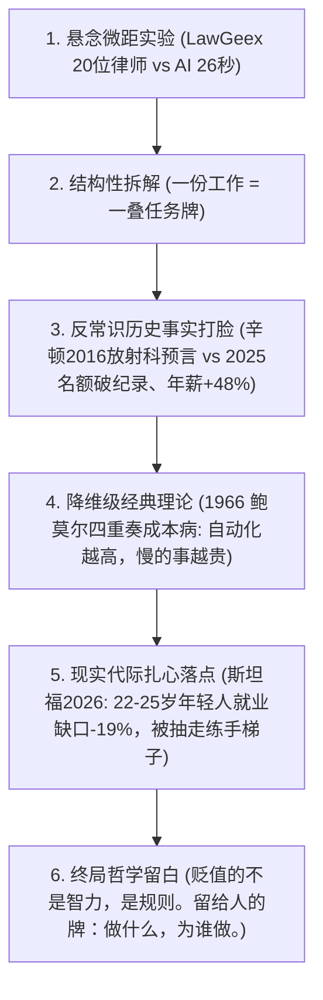

# Vibe 知识大赏 · 电影感视听与工程美学标准 (V3.0 实战手册)

> **目标与定位**：本手册为“Vibe知识大赏”系列电影感 AI 知识视频的核心美学与工程标准文档。从 Claude Opus 5.5 架构及《智力贬值时代》V3 纯代码重制版中逆向提炼，系统解析**“为什么高级”、“怎么写出电影感”**的底层逻辑。
>
> 适用于后续所有视频页面的代码实现、动效设计、文案编写与审美自检。

---

## 〇、核心美学哲学：克制即昂贵 (Restraint as Luxury)

1. **拒绝“PPT 汇报感”与“网页插画感”**：
   - 低级的动效在**做加法**：满屏五彩渐变、爆炸粒子、花哨弹跳、荧光色块。
   - 高级的视听在**构建物理现场**：暗房深夜书桌、台灯斜射微光、纸叠物理厚度、镜头暗角、35mm 胶片动态噪点。
2. **拒绝“情绪贩卖与空洞大词”**：
   - 绝不堆砌“奇点降临”“大厂全员下岗”“算力风暴”等口水词；
   - 必须构筑**“具象物理隐喻 + 真实学术反转 + 降维理论模型 + 哲学尊严收尾”**的完整四阶认知链。

---

## 一、电影级后期光学链 (The Optical Post-Processing Pipeline)

普通 Canvas 画面之所以生硬，是因为它只有“数字像素”，缺乏真实物理镜头的光学缺陷。全片必须在最终输出前经过三道光学滤镜合成（参考 `zhili/core3.js:post`）：

```javascript
/* ================= 电影级后期光学处理器 ================= */
// 1. 初始化 1/4 分辨率辉光离屏画布 (480x270)，性能极高
const BLOOM = document.createElement('canvas'); 
BLOOM.width = 480; BLOOM.height = 270;
const BX = BLOOM.getContext('2d');

// 2. 预生成 4 组确定性 35mm 胶片颗粒 (Grain)，按 30fps 轮转
const GRAIN = [];
(function(){ 
  const r = mulberry32(99);
  for (let k = 0; k < 4; k++){ 
    const c = document.createElement('canvas'); c.width = 960; c.height = 540;
    const g = c.getContext('2d'), id = g.createImageData(960, 540);
    for (let i = 0; i < id.data.length; i += 4){ 
      const v = 128 + (r() - .5) * 255;
      id.data[i] = id.data[i+1] = id.data[i+2] = v; id.data[i+3] = 255; 
    }
    g.putImageData(id, 0, 0); GRAIN.push(c); 
  } 
})();

function postProcess(t, fade = 0){
  // 步骤 A：提取高对比度亮部并高斯模糊，以 lighter 混合叠加回主画布（柔和镜头光晕）
  BX.clearRect(0, 0, 480, 270);
  BX.filter = 'brightness(.5) contrast(2.6) blur(8px)';
  BX.drawImage(SCN, 0, 0, 480, 270);
  BX.filter = 'none';
  X.save(); 
  X.globalCompositeOperation = 'lighter'; 
  X.globalAlpha = .32; 
  X.drawImage(BLOOM, 0, 0, 1920, 1080); 
  X.restore();

  // 步骤 B：电影镜头径向暗角 (Vignetting) —— 边缘压暗 66%，将视线死死锁定在中心
  const v = X.createRadialGradient(960, 520, 380, 960, 540, 1200);
  v.addColorStop(0, 'rgba(0,0,0,0)');
  v.addColorStop(1, 'rgba(0,0,0,.66)');
  X.fillStyle = v; 
  X.fillRect(0, 0, 1920, 1080);

  // 步骤 C：35mm 胶片动态噪点 —— 以 overlay 模式注入 7% 极弱颗粒，彻底消除数字色阶断层
  X.save(); 
  X.globalCompositeOperation = 'overlay'; 
  X.globalAlpha = .07;
  X.drawImage(GRAIN[Math.floor(t * 30) % 4], 0, 0, 1920, 1080); 
  X.restore();

  if (fade > 0){ X.fillStyle = `rgba(0,0,0,${fade})`; X.fillRect(0, 0, 1920, 1080); }
}
```

---

## 二、真实物理材质与微距光影原语

### 1. 深胡桃木书桌与年轮反光 (`drawRoom`)
- **不仅是黑底**：背景是深夜暗房书桌环境，中心向外 `createRadialGradient` 渐变（`#15122A` $\to$ `#0A0918` $\to$ `#030209`）。
- **木质年轮切光**：
  ```javascript
  // 用递增平方公式画出有机木纹
  for (let i = 1; i < 15; i++){
    const y = 738 + i * i * 1.6;
    X.beginPath(); X.moveTo(0, y);
    X.bezierCurveTo(640, y + 4, 1280, y - 4, 1920, y + 2); X.stroke();
  }
  // 桌面边缘切光高光线
  X.fillStyle = 'rgba(255,210,150,0.13)'; X.fillRect(0, 733, 1920, 2);
  ```

### 2. 纸张层叠与台灯斜射掠光 (`paper`)
- **厚度层叠**：禁止只画单层白色矩形！在下方连续画 3-5 层微错开且明度递减的暗纸边缘（`rgb(200 - i*14, ...)`），赋予纸张真实的纸浆物理厚度。
- **环境光入射**：右上角打入微弱的暖光线性渐变（`rgba(255,240,215,.22) -> 0`），模拟书桌台灯的侧光。
- **排版拟真**：文字行用圆角线段模拟（段落末行缩短为 45%~65%），画出真实法律合同/学术论文版式。

### 3. 卡片 3D 翻转与重力阴影 (`card`)
- **余弦透视翻折**：`X.scale(Math.abs(Math.cos(f * Math.PI)), 1)` 模拟绕 Y 轴翻转，在极低消耗下实现 3D 翻牌。
- **升降下沉阴影**：当卡片被抓起抬升（`lift`）时，`shadowOffsetY` 从 16 动态增加到 26，羽化随之放大；落地时收缩紧贴。

### 4. 欠阻尼物理弹簧振荡器 (`spring`)
- 凡是卡片落定、指针归位、天平摆动，严禁使用匀速或单一 ease：
  $$\text{spring}(k, \omega=13, \gamma=6) = 1 - e^{-\gamma k} \cos(\omega k)$$
  具备一次干脆利落的“微过冲（Overshoot）”，带来极其扎实的机械落定手感。

---

## 三、色彩语义学与四重字体交响

### 1. 色彩语义字典 (严格克制)

| 色彩角色 | 十六进制色值 | 精神内核与视觉语义 |
|---|---|---|
| **Gold (复古金)** | `#D3B272` / `#9C7E45` | 崇高人性、拍板权力、留给人类的终极价值 |
| **Cold Light (冷白蓝)** | `#A9D8FF` / `#DCEBFA` | 冰冷机器、无情算法、照章办事的规章与自动化 |
| **Red (砖红)** | `#C8463A` | 审查红笔、被淘汰与被替代的阵痛损失 |
| **Paper (旧纸米白)** | `#EDE4D3` / `#BBAC92` | 沉淀知识的羊皮纸与做旧文档质感 |
| **Ink (暗紫墨黑)** | `#2A2433` | 印刷油墨与阴影交界 |
| **Dim (辅助冷灰)** | `#8A8AA0` / `#9C9AB2` | 注释证据链、英文斜体对照 |

### 2. 四重字体分工法则

```css
/* 引入规范 */
@import url('https://fonts.googleapis.com/css2?family=Noto+Serif+SC:wght@500;700;900&family=Noto+Sans+SC:wght@400;500;700&family=EB+Garamond:ital,wght@0,500;1,400&family=JetBrains+Mono:wght@400;700&display=swap');
```

1. **Noto Serif SC (思源宋体 700/900)**：用于中央核心片名、关键中文主句。承载东方人文与哲学厚重感。
2. **Noto Sans SC (思源黑体 500)**：用于顶部标签、左上水印、刻度尺标签。充当理性克制的基础骨架。
3. **JetBrains Mono (等宽极客体 700)**：用于计时器、百分比狂飙、金额与统计年份。传递冷峻的算法工业精度。
4. **EB Garamond (古典衬线斜体 400)**：用于副标题英文、引文出处、英文小字。传递欧洲经典手稿的典雅气质。

### 3. 无框浮空字幕（弃用贴片矩形）

摒弃生硬突兀的底框色块，改用“空气漫反射双层晕光”：
```css
#subtitle {
  font: 700 46px 'Noto Serif SC';
  color: #EFEAF6;
  letter-spacing: 2px;
  /* 双层弥散阴影：底层保锐利，外层托底漫反射 */
  text-shadow: 0 2px 6px rgba(0,0,0,.9), 0 0 34px rgba(0,0,0,.85);
}
#subtitle em { font-style: normal; color: #D9B877; }
#subtitle-en {
  margin-top: 12px;
  font: italic 400 27px 'EB Garamond', serif;
  color: #9C9AB2;
  text-shadow: 0 2px 10px rgba(0,0,0,.9);
}
```

---

## 四、视听同构：声画时间网格 (Audio-Visual Phrase Grid)

**音画不同步是劣质科普的通病；高级感来自于严格的节拍对齐。**

1. **实测 BGM 节拍常数**（`assets/audio/MidnightRush(旋律很哇塞)-云杪栖光.mp3`，2026-10 复核）：
   - $BPM = 112.90$
   - 1 拍 $BEAT = \frac{60}{112.90} \approx 0.5314\text{s}$
   - 1 小节 $BAR = 4 \times BEAT \approx 2.1258\text{s}$
   - 首拍起点偏移 $BAR_0 = 0.228\text{s}$
   - 4 小节乐句 $= 8.503\text{s}$；8 小节乐句 $= 17.006\text{s}$
   - 转换函数：`bar(n) = BAR0 + n * BAR`
   - 旧值 112.25 / 0.235 会让 160s 累计漂移约 0.9s，已废弃。
2. **实测结构锚点**（同一首曲子的前 160s，直接拿来切）：
   - `bar(8) = 17.234s` 主歌进入
   - `bar(16) = 34.240s` 8 小节乐句头
   - `bar(24) = 51.247s` B 段
   - `bar(36) = 76.756s` breakdown
   - `bar(44) = 93.762s` drop
   - `bar(56) = 119.271s` 新 8 小节块
   - `bar(70) = 149.032s` 尾段；`bar(72) = 153.284s` 收束
   - `bar(74) = 157.535s` 淡出；`bar(75) = 159.661s` 下一段进入
3. **乐句小节对齐铁律**：
   - 章节转场、大场景镜头切换优先锁定在 4/8 小节乐句头（8 小节 = 17.006s）；标题卡、尾卡这类短段允许锁在小节头；
   - 字幕默认行长 **6 拍（1.5 小节，3.188s）**，短句 4–5 拍，情绪句 8 拍；不要用 3.0s 这类非节拍整数时长；
   - 旁白字幕起止时间锁定在小节线上（通常在拍点后弱起 `bar(n + 0.25)` 入场，淡入时间 $0.35\text{s}$，带有自然的视听交错感）；
   - 30fps 下 1 拍 = 15.94 帧、1 小节 = 63.77 帧；用绝对公式 `round((BAR0 + n * BAR) * 30)` 取帧，禁止逐小节累加 64 帧（75 小节会漂 0.57s）。
4. **完整网格与期次对照**：见 [`bgm-beat-map.md`](bgm-beat-map.md)（0–75 小节逐条时间/帧号、结构锚点、低能量小节、字幕拍数分布、配置自检命令）。本节保留原则，具体数字以卡点表为准。
5. **可选语义音效层（不替代 BGM）**：BGM 负责情绪，音效只标注“事件发生”。在 `episodes/<slug>/assets/sfx.json` 写 cue 表（`{"t": 秒}` 或 `{"bar": 小节, "beat": 拍, "offset": 秒}`，反向 whoosh 用 `"align": "end"` 对齐落点），运行 `python scripts/make_sfx.py <cue.json>` 生成 44.1kHz 立体声 `assets/sfx.wav`，并把 `episode.json.sfx` 指向它。音效点优先落在小节线/拍点与视觉落点上，密度宁少勿多（全片通常 10–20 个）；渲染端与 BGM 1:1 混合后统一 `loudnorm=I=-14:TP=-1`，不做逐条响度争夺。`sfx.wav` 是可再生成的产物（已被 `.gitignore` 忽略），cue 表才是可复现源。

---

## 五、叙事升维：六阶装甲叙事架构

解决“空话连篇、观点单薄”的黄金五步法：



---

## 六、工业级渲染稳定性清单 (Code Safety Checklist)

在编写任何新 HTML 页面时，必须满足以下硬性条件：

1. **全字符子集显式预加载**：
   ```javascript
   window.setup = function(done){
     const all = JSON.stringify([SUBTITLES, NOTES, SECTIONS, DECKS, TXT]) + '0123456789:%+−—,.·《》VIBE知识大赏';
     const faces = [`700 40px 'Noto Serif SC'`, `900 40px 'Noto Serif SC'`, `700 40px 'JetBrains Mono'`, ...];
     Promise.all(faces.map(f => document.fonts.load(f, all).catch(() => null)))
       .then(() => document.fonts.ready).then(() => { window.render(0); done && done(); });
   };
   ```
   **彻底杜绝无头浏览器截图前几秒文字使用系统默认 Arial 的致命 Bug。**
2. **视口自适应等比缩放**：
   使用 `fit()` 将 1920×1080 居中缩放渲染在屏幕内，无论是手机查看还是宽屏调试均绝不跑位变形。
3. **渲染模式绝对安全接管**：
   检测到 `window.__RENDER_MODE__ = true` 时，立即 `return` 停止原生 rAF 播放循环，隐藏控制器与调试提示符。
4. **代码工程分层**：
   禁止将几千行混在一个 HTML 中！必须拆解为：
   - `config.js`：文案、时间轴、牌组配置（解耦内容）
   - `core*.js`：数学、物理弹簧、光影后期、手绘矢量原语
   - `scenes_*.js`：各章节镜头绘制逻辑
   - `main.js`：调度引擎与时间驱动
